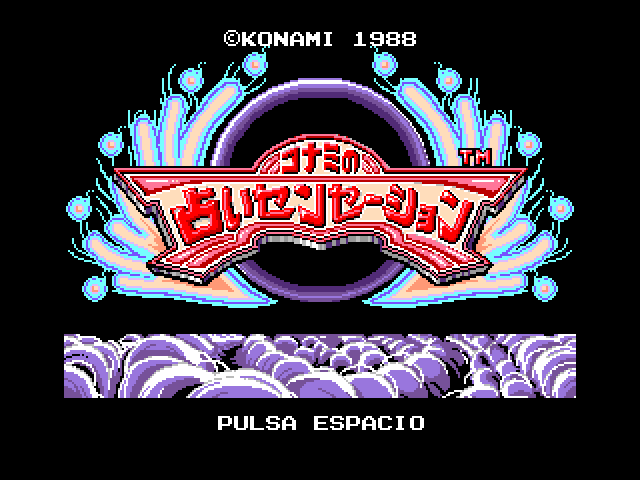
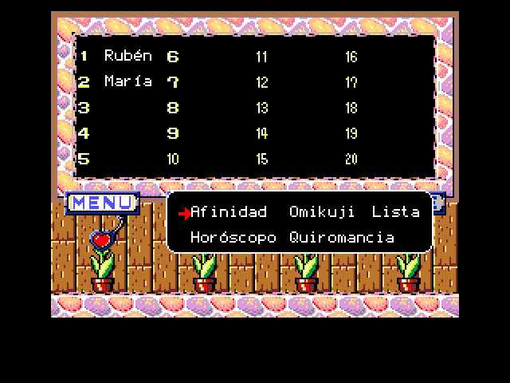
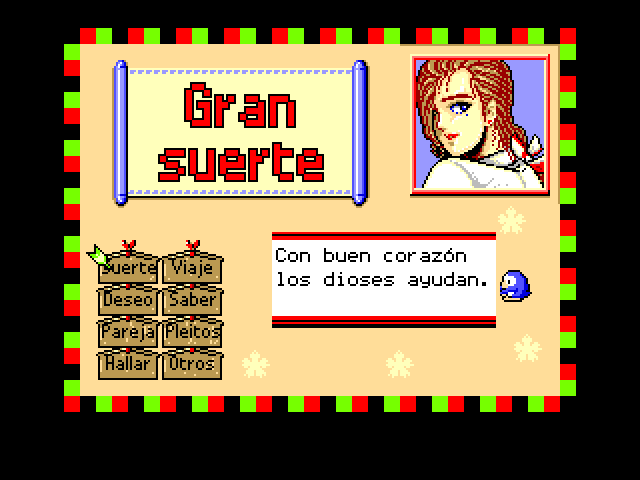
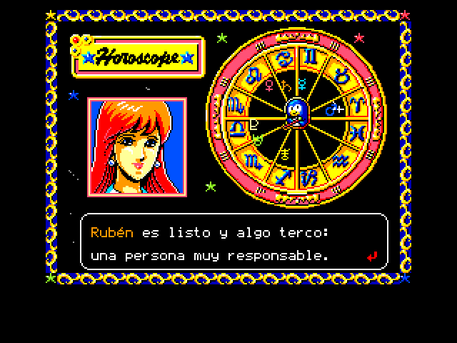
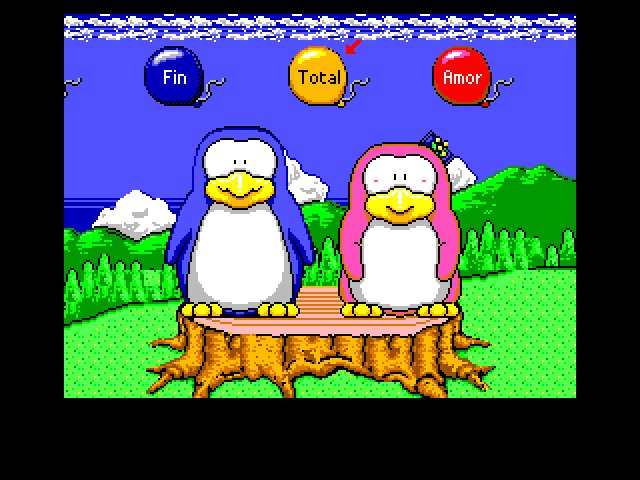
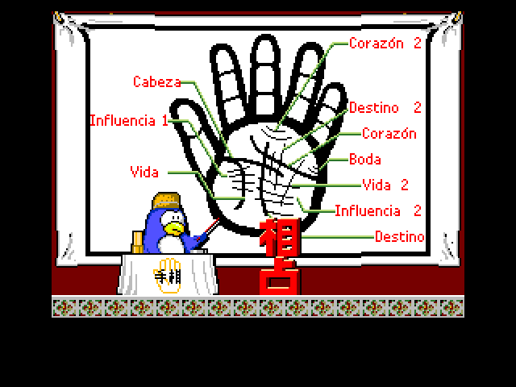
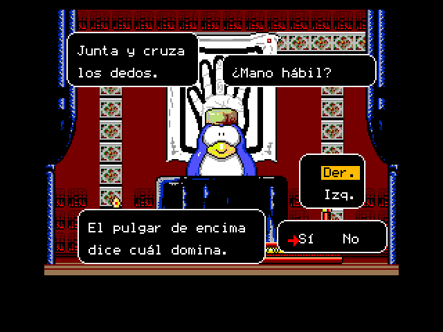

# Uranai Sensation en castellano (MSX2)

Traducción al castellano de **Konami's Uranai Sensation** (コナミの占いセンセーション, Konami, 1988) para MSX2. Es un programa de adivinación con cuatro artes: afinidad por grupo sanguíneo, omikuji (la suerte en tablillas de un santuario), horóscopo occidental y quiromancia. Se registra a cada persona con su nombre, fecha, hora y lugar de nacimiento, grupo sanguíneo y sexo, y el juego le echa la buenaventura.

Se publica como **parche IPS** para la imagen de disco. No se incluye ningún disco: necesitas tu propia copia del juego original.



## Qué tiene la traducción

* **Todo el texto en castellano**: lista de personas, registro, afinidad, omikuji, horóscopo, quiromancia (preguntas, resumen y resultados) y salida por impresora.
* **Fuente latina propia** de 6 píxeles con ñ, tildes, ü, ¿ y ¡.
* **Concordancia de género**: las frases con «-o/-a» se adaptan al sexo de la ficha de cada persona.
* **Gráficos con japonés redibujados**: título, menús, tablillas y pergaminos de la omikuji, calendario, botones y título del horóscopo, letrero de la afinidad, globos, lámina y cabeceras de la quiromancia y el mapa del lugar de nacimiento («Mar», «Ext», «Otros»).
* El resumen de líneas de la mano y el menú de resultados, que en el original iban en columnas verticales, pasan a ser **listas**.
* Las fechas se piden en **años 19xx** en lugar de la era Showa.
* **Arreglado un fallo del original**: en la pantalla de líneas de la mano, pulsar ← con una persona nueva llenaba la pantalla de basura.
* Los textos van comprimidos en la RAM extra, así que **hace falta un MSX2 con 128 KB**. Con 64 KB el juego lo avisa en pantalla y se para.

| | |
|---|---|
|  |  |
|  |  |
|  |  |

## Descargas

En [`releases/`](releases/):

| Fichero | Qué es |
|---|---|
| `UranaiSensation_ES_v1.0.ips` | Parche IPS. SHA-1 `e1cc3108ccaa705019e7860a3c0af551a3cc6beb`. |

El parche **solo** vale para esta imagen:

| Disco | Tamaño | SHA-1 |
|---|---|---|
| `Konami's Uranai Sensation. Fortune Teller (1988)(Konami)(JP).dsk` | 720 KB | `f9499b9797c3bfe57623d5f82b578eb04787b364` |
| Resultado tras aplicar el parche | 720 KB | `fb4bbcd1f567716e3a9cab811f64e19692b12f79` |

Para aplicarlo sirve cualquier programa de parches IPS, como [Floating IPS](https://www.smwcentral.net/?p=section&a=details&id=11474) (`flips --apply UranaiSensation_ES_v1.0.ips original.dsk traducido.dsk`) o Lunar IPS. Comprueba el SHA-1 del disco antes y después: otros volcados (los [a], [a2] y [a3]) no valen.

Se ha probado en openMSX con el Sony HB-F900 (MSX2 con 128 KB), pasando por todas las opciones.

## Cómo se juega

* **Cursores** para moverse, **ESPACIO** para elegir y avanzar el texto.
* Los iconos de la lista: **MENU** abre las adivinaciones, **INPUT** registra a una persona nueva, **DISPLAY** muestra sus datos y **DELETE** la borra.
* Los nombres admiten hasta **5 letras**, para que quepan en el cuadro de la lista.
* El sello 相占 de la lámina de la mano y el rótulo 手相 de la mesa se han dejado en japonés: son decorativos.

## Cómo se compila

Hacen falta **Python 3** y **sjasmplus** en el PATH (se comprobó con sjasmplus 1.24.0). El repositorio no incluye nada del juego: el código y los datos se leen de **tu propio disco**.

```sh
# 1. Copia tu disco original como orig.dsk junto a build.py (comprueba el SHA-1 de arriba)
#    (o indica otra ruta con la variable URANAI_ORIG; sjasmplus también con SJASMPLUS)
# 2. Monta el disco traducido: uranai_es.dsk (y uranai_es_prueba.dsk, con dos personas de prueba)
python3 build.py
# 3. Crea el parche: da el mismo IPS que el de releases/
python3 tools/ips.py
```

## Qué hay en el repositorio

| Carpeta | Contenido |
|---|---|
| `trad/` | Los textos en castellano: interfaz y menús (`ui.txt`), afinidad (`grupo_sanguineo.txt`), omikuji, horóscopo y quiromancia. |
| `src/` | `eng.asm`: el cargador nuevo, el motor de texto comprimido y los parches de código. `sexo.asm`: la concordancia de género. |
| `tools/` | Juego de caracteres y fuente latina, compresión, corte de líneas, teclado de nombres, lectura del disco original y creación del parche. |
| `gfx/` | Los gráficos redibujados. |
| `build.py` | Monta el disco a partir de tu `orig.dsk`. |
| `docs/` | Documentación técnica y lecciones. |
| `images/` | Capturas. |
| `releases/` | El parche IPS. |

## Documentación

* [Documentación técnica](docs/DOCUMENTACION.md): estructura del disco, módulos, rutinas, formato de los textos y de las fichas, cómo está hecha la traducción y el fallo del original.
* [Lecciones](docs/LECCIONES.md): lo aprendido, útil para traducir otros juegos de MSX.

## Créditos

* **Konami's Uranai Sensation** (1988): Konami.
* **Traducción al castellano** (2026): dirección y pruebas, araubi.
* Ingeniería inversa, traducción, código, gráficos redibujados y documentación: desarrollado con Claude (Anthropic).
* No se ha usado ningún desensamblado ni traducción previa de terceros.
* Herramientas: sjasmplus y openMSX.

## Licencia y avisos

* **Código y herramientas propios** (`build.py`, `src/`, `tools/`): licencia MIT, ver [LICENSE](LICENSE).
* **Traducción, documentación, fuente latina y retoques gráficos** (`trad/`, `docs/`, este README, `tools/font6.txt`, `gfx/`): CC BY-NC-SA 4.0, ver [LICENSE-CC](LICENSE-CC).
* **El juego original no está cubierto por estas licencias.** Uranai Sensation, su código, gráficos, música y textos son de Konami y de sus autores. Los gráficos de `gfx/` son retoques de los originales: los cambios son nuestros, la base es de Konami. Las capturas de `images/` muestran el juego y tampoco están cubiertas.
* Es un homenaje sin ánimo de lucro. No se incluye ningún disco, ni el original ni el traducido, ni volcados del juego. Si algún titular de derechos lo pide, se retirará.
